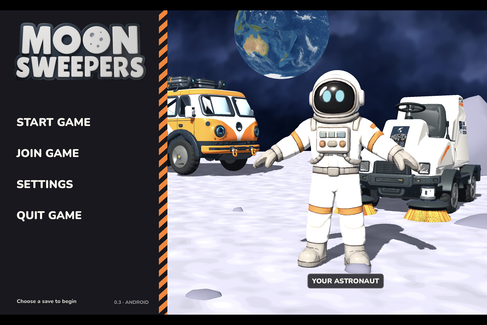
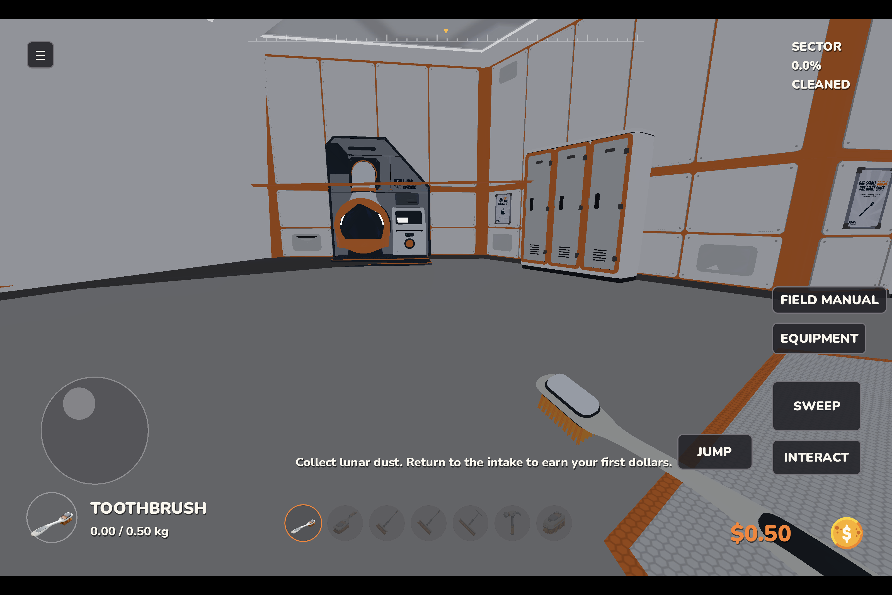

# Mooni — Moon Sweepers Android reconstruction

A work-in-progress native Android rebuild using locally recovered Moon Sweepers assets and a new Godot implementation. It runs on Android ARM64 with touch controls; it does not stream or emulate the Windows executable.

**This is an incomplete reconstruction, not a complete or official Android port. The original source code was not fully recovered.**

## Download the APK

[Download version 0.3.2 from GitHub Releases](https://github.com/pali2410/mooni/releases/tag/v0.3.2)

The signed debug APK is approximately 379 MB and targets `arm64-v8a`. It was installed and checked on a Xiaomi Pad 8 running Android 16. Other devices and physical controllers have not been comprehensively tested.

SHA-256:

```text
2454b3f9f991478ae538a9a76c4d3062334d5fd34d748047ae98b51f8d901a16
```

The APK is attached to the release rather than stored in Git history. Download it on your Android device and open it with the package installer.

## What currently works

- Original starting-base geometry and four captured terrain chunks: 215 render instances with their captured transforms and material slots.
- 31 original starting-area collision shapes, moving entrance doors and clearance checks for the entrance steps.
- Reference-based home screen, five local save slots, tool HUD, compass and wallet display.
- Touch movement, camera look, sweeping, jump, interaction and equipment controls.
- A finite deformable dust patch, container capacity, earned deposits and tool purchases.
- Fresh saves start at zero dollars with the Toothbrush. There is no unlimited-money or max-upgrade preset.
- Saved tool IDs are normalized so purchased tools remain available after a restart.

Read [BUILD-STATUS.json](BUILD-STATUS.json) for verification scope and [the parity checklist](MoonSweepers-Native-Rebuild/FEATURE-PARITY.md) for unfinished systems. The earlier tablet cleaning/deposit check used v0.3.0; v0.3.2 adds tested step-handling and purchase-reload fixes and was separately installed and hash-verified.

## Screenshots

Android home screen, v0.3.2:



Original base interior reached on the tablet, v0.3.1:



## What remains unfinished

Original humanoid animation and IK, exact shaders and lighting, complete dust simulation, the wider spherical world, full rigid-body and vehicle physics, functional factories/conveyors/robots/power, all upgrades, contracts/story, appearance editing and multiplayer. Static models and copied collision shapes do not establish restored gameplay behavior.

## Open the project

1. Clone this repository. It includes the converted assets used by the current rebuild, so the checkout is large.
2. Open `MoonSweepers-Native-Rebuild/game/project.godot` in Godot 4.7.2 stable.
3. Allow Godot to import the assets, then run the project.

Desktop controls: WASD, right mouse drag to look, left mouse to sweep, Space to jump, E to interact, Tab for equipment and Escape to pause. On Android, use the on-screen controls.

## Build Android on Windows

Install a JDK and Android SDK appropriate for Godot Android export. Set `JAVA_HOME` and `ANDROID_HOME` (or `ANDROID_SDK_ROOT`). The configuration script also checks Java on PATH and the usual local Android SDK location.

From the repository root:

```powershell
python moon-mod/setup-native-rebuild.py
python moon-mod/configure-native-export.py
& '.\MoonSweepers-Native-Rebuild\tools\godot\Godot_v4.7.2-stable_win64_console.exe' --headless --path '.\MoonSweepers-Native-Rebuild\game' --editor --import
& '.\MoonSweepers-Native-Rebuild\tools\godot\Godot_v4.7.2-stable_win64_console.exe' --headless --path '.\MoonSweepers-Native-Rebuild\game' -- --smoke-test
& '.\MoonSweepers-Native-Rebuild\tools\godot\Godot_v4.7.2-stable_win64_console.exe' --headless --path '.\MoonSweepers-Native-Rebuild\game' --export-debug Android
```

The setup script downloads the pinned official editor and Android debug template. The configuration script generates a local debug signing key. Signing keys, generated tools, local saves, build caches and private device reports are excluded from this repository. Locally generated signing keys differ from the published APK's key.

## Recovery tools and project notes

`moon-mod/` contains selected extraction, reference-preparation and read-only runtime-capture helpers. Re-running recovery requires the original local game and recovery tree, which are separate inputs; cloning this repository does not recover missing source code. Conversion helpers use Python packages including NumPy, UnityPy, PyYAML, Pillow and Frida.

See [the environment capture notes](MoonSweepers-Native-Rebuild/analysis/WORLD-REFERENCE-2026-10-29.md) and [the reconstruction brief](docs/RECONSTRUCTION-BRIEF.md).

Moon Sweepers game identity and original assets are credited to their original creators. This repository documents an independent reconstruction experiment.
